<div align="center">

# Mars Science Lab

**NASA's Mars Science Laboratory for Kerbal Space Program 1.12**

[](CHANGELOG.md)
[](#requirements)
[](LICENSE.md)
[](../../releases/latest)

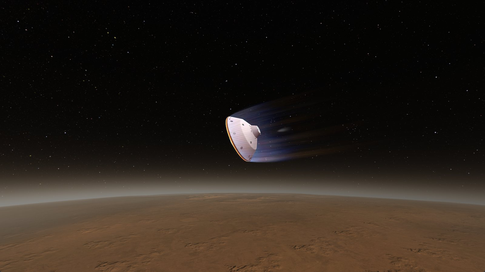

[Features](#features) · [Spacecraft](#the-spacecraft) · [Screenshots](#game-screenshots) · [Requirements](#requirements) · [Installation](#installation) · [Building](#building-the-plugins) · [Modding](#modifying-models-and-textures)

</div>

## Features

- **Full flight system at 1:1** — cruise stage, aeroshell with parachute bay, Sky Crane and Curiosity, each a separate part. Rescaled automatically for stock, JNSQ or KSRSS when RealSolarSystem is not installed.
- **Automatic EDL** — guided entry towards Bradbury Landing, parachute, heat shield and backshell separation, powered descent, rover lowering and flyaway. Trigger any step manually, or turn Auto EDL off and fly it yourself.
- **A working rover** — rocker-bogie drive, robotic arm with drill, deployable mast and ten experiments: SAM, CheMin, MAHLI, APXS, ChemCam, Mastcam, DAN, RAD, REMS and MARDI.
- **Career contracts** — land Curiosity on Mars (or Duna) and return its first drill sample results (requires Contract Configurator).
- **Mod support** — optional patches for the RO family, FAR, RealChute, Waterfall, Kerbalism, MechJeb2, Firefly and more.

## The spacecraft

<table>
  <tr>
    <td width="50%" align="center">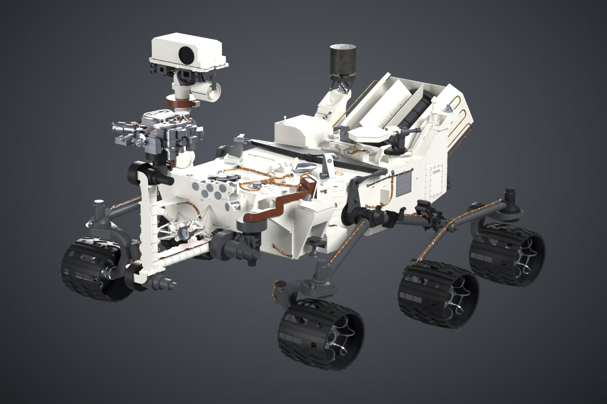<br><b>Curiosity rover</b></td>
    <td width="50%" align="center">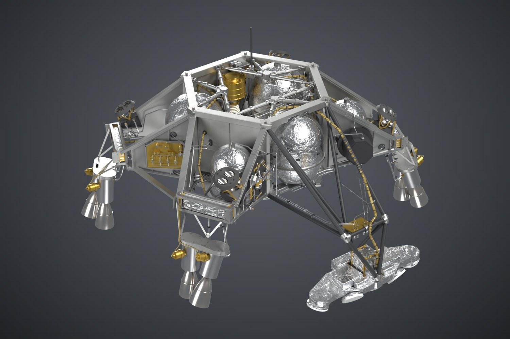<br><b>Sky Crane descent stage</b></td>
  </tr>
  <tr>
    <td align="center">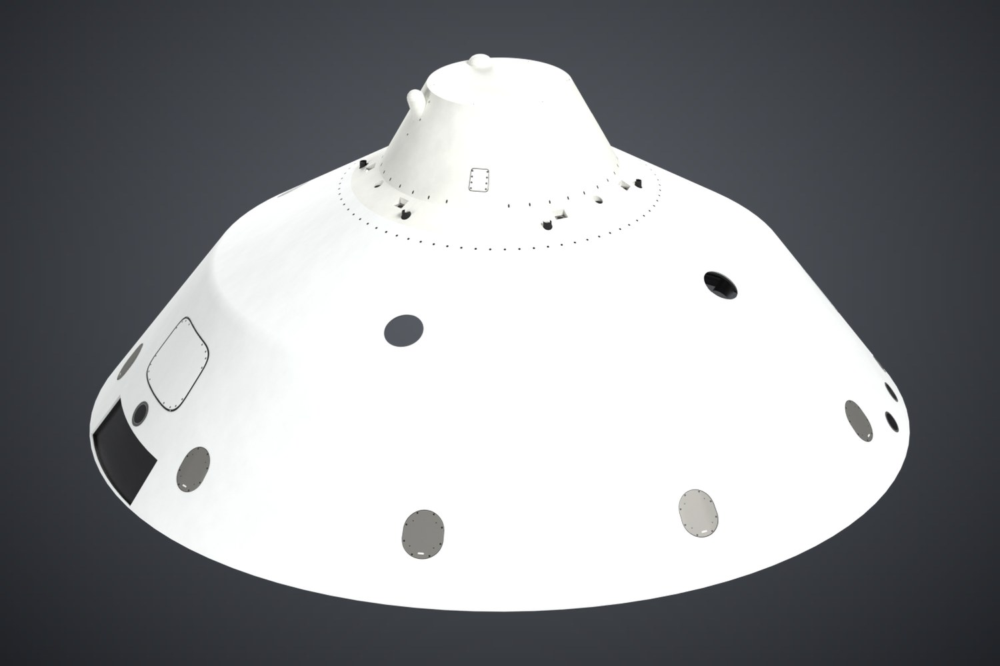<br><b>Backshell</b></td>
    <td align="center">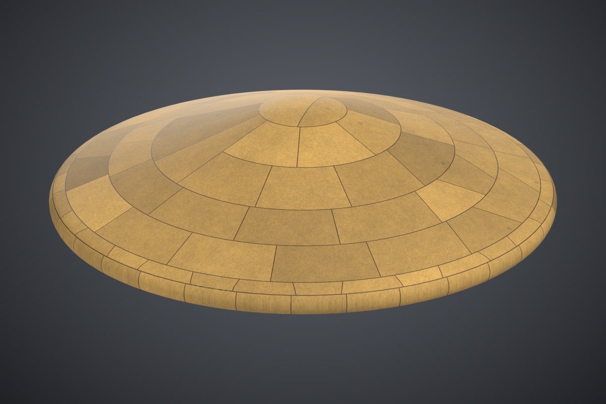<br><b>Heat shield</b></td>
  </tr>
  <tr>
    <td colspan="2" align="center">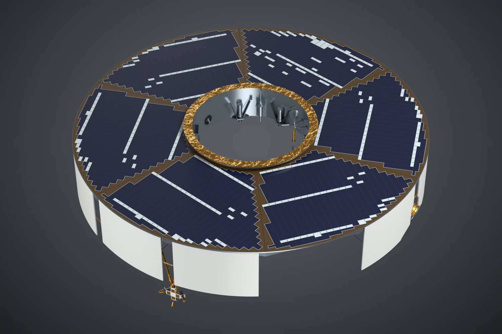<br><b>Cruise stage</b></td>
  </tr>
</table>

## Game Screenshots

<table>
  <tr>
    <td width="50%" align="center">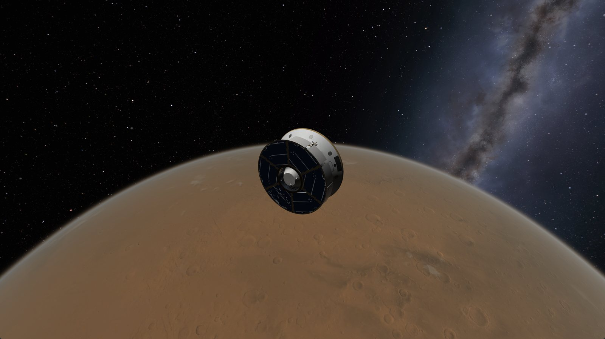<br><sub><b>Cruise stage</b></sub></td>
    <td width="50%" align="center">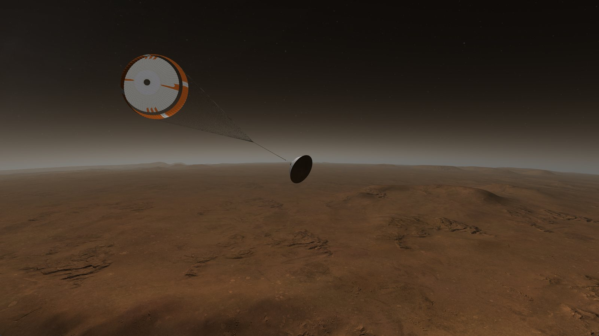<br><sub><b>Parachute</b></sub></td>
  </tr>
  <tr>
    <td align="center">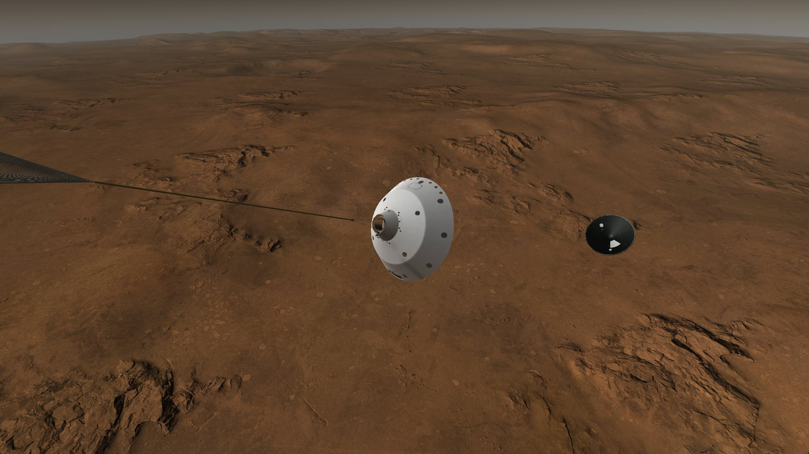<br><sub><b>Heat shield jettison</b></sub></td>
    <td align="center">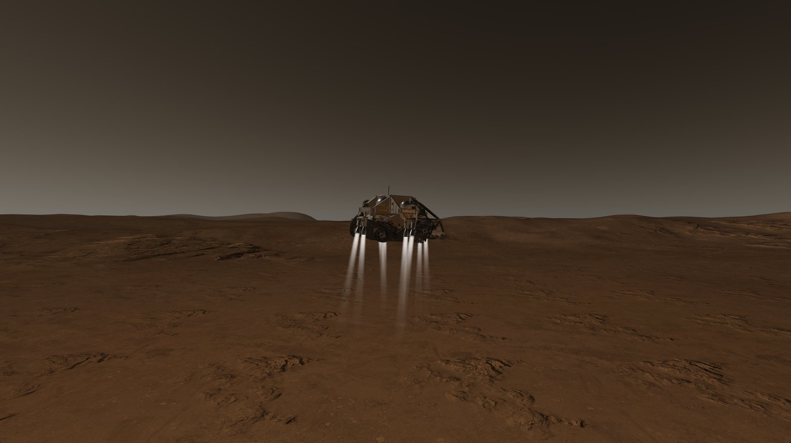<br><sub><b>Powered descent</b></sub></td>
  </tr>
  <tr>
    <td colspan="2" align="center">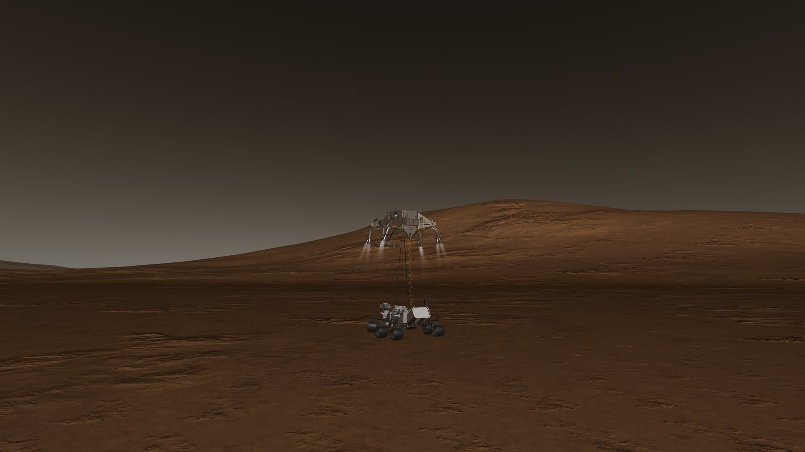<br><sub><b>Sky Crane</b></sub></td>
  </tr>
</table>

## Requirements

**Required**

- KSP 1.12.x
- [ModuleManager](https://github.com/sarbian/ModuleManager) 4.2+
- [Textures Unlimited](https://github.com/KSPModStewards/TexturesUnlimited) — parts render black without it

**Optional** — patches apply only when the mod is installed

[RealSolarSystem](https://github.com/KSP-RO/RealSolarSystem) ·
[RealismOverhaul](https://github.com/KSP-RO/RealismOverhaul) ·
[RP-1](https://github.com/KSP-RO/RP-1) ·
[RealFuels](https://github.com/KSP-RO/RealFuels) ·
[RealAntennas](https://github.com/KSP-RO/RealAntennas) ·
[Kerbalism](https://github.com/Kerbalism/Kerbalism) ·
[FAR](https://github.com/KSPModStewards/Ferram-Aerospace-Research) ·
[RealChute](https://github.com/ChrisViral/RealChute) ·
[Waterfall](https://github.com/KSPModStewards/Waterfall) ·
[MechJeb2](https://github.com/MuMech/MechJeb2) ·
[Contract Configurator](https://github.com/KSP-RO/ContractConfigurator) ·
[Firefly](https://github.com/M1rageDev/Firefly)

## Installation

1. Remove any previous `GameData/MarsScienceLab` folder.
2. Copy `GameData/MarsScienceLab` into `KSP/GameData`.
3. Copy `Ships/VAB/*.craft` into `KSP/Ships/VAB`.

## Repository layout

| Path | Contents |
|---|---|
| `GameData/MarsScienceLab/` | The mod: parts, patches, models, textures, localization and the three compiled plugins |
| `Ships/VAB/` | Craft files: full spacecraft and rover alone, each at 1:1 and stock scale |
| `tools/plugin/` | `MSLAeroshell.dll` source — aeroshell, entry guidance, parachute, scaling, status window |
| `SkyCrane/plugin/` | `MSLSkyCrane.dll` source — powered descent and Sky Crane |
| `Curiosity/plugin/` | `MSLCuriosity.dll` source — rover mechanisms, arm, science |

The DLLs in `GameData/MarsScienceLab/Plugins` ship prebuilt; build them only if you change the code.

## Building the plugins

You need Windows with the .NET Framework 4 compiler (`csc.exe`, included with Windows 10/11) and a KSP 1.12 install to compile against. Each script reads the KSP folder from `-KspRoot` or `KSP_ROOT` and writes its DLL into `GameData/MarsScienceLab/Plugins`:

```powershell
$env:KSP_ROOT = 'C:\Games\Kerbal Space Program'
.\tools\plugin\build_plugin.ps1
.\SkyCrane\plugin\build_plugin.ps1
.\Curiosity\build_plugin.ps1
```

Scripts skip the build when the sources are unchanged (`tools/plugin_stamps.json`); add `-Force` to rebuild, e.g. after a KSP update. Git Bash users can run `tools/plugin/build_plugin.sh <KSP folder>` and `SkyCrane/plugin/build_plugin.sh <KSP folder>` (no stamp check).

GitHub Actions compiles all three on every change to the C# sources (`.github/workflows/build.yml`), against the stripped KSP 1.12.5 reference assemblies from [KSPLibs](https://github.com/KSPModdingLibs/KSPLibs). Releases package the DLLs built there.

## Modifying models and textures

| | Tool |
|---|---|
| **Models** | Blender + the KSP `.mu` add-on (`io_object_mu`) |
| **Textures** | Any DDS editor with DXT1/DXT5 (GIMP 2.10+, Paint.NET, NVIDIA Texture Tools). KSP 1.12 rejects BC5/BC7 and uncompressed DDS. |

> [!WARNING]
> **Meshes have no tangents.** They are computed at load time by `MSLAeroshell.dll` (`tools/plugin/MSLTangents.cs`); keep it installed or normal maps light incorrectly. Exported tangents are used as-is.
>
> **Some assets are shared.** One wheel part (`MSL_Curiosity_Wheel`, Standard/Mirrored) serves all six wheels. Some right-side harness meshes are filled at load from their left-side copies (`Assets/MSL_SharedMeshes.cfg`). Most textures, such as `ANODIZED_BLACK_ksp`, are used by many parts.
>
> **Materials are matched by name.** `Patches/*_TexturesUnlimited.cfg` assigns TU/Metallic materials by object name and texture path, so renaming an object or texture breaks it; a missing `_NRM` renders black. Each material uses `<name>_ksp` (albedo), `<name>_ksp_NRM` (normal) and `<name>_ksp_met` (R metallic, G AO, A smoothness).
>
> **Normal maps are DXT5nm.** X in alpha, Y in green, red and blue white. Plain RGB DXT5 gives wrong lighting — swizzle before compressing, or use your tool's DXT5nm option.

## Notes

**Author:** Polsct · **License:** [MIT](LICENSE.md) · [Notice](NOTICE.md) · [Changelog](CHANGELOG.md)

<sub>A fan recreation of NASA's Mars Science Laboratory based on public reports and photographs; some dimensions are estimated. Not affiliated with or endorsed by NASA, JPL or the spacecraft's builders. Parts of the rover mesh are derived from the Curiosity Rover model, and the rocker-bogie suspension meshes from the Mars 2020 Perseverance Rover model, both by NASA 3D Resources (NASA/JPL-Caltech).</sub>
